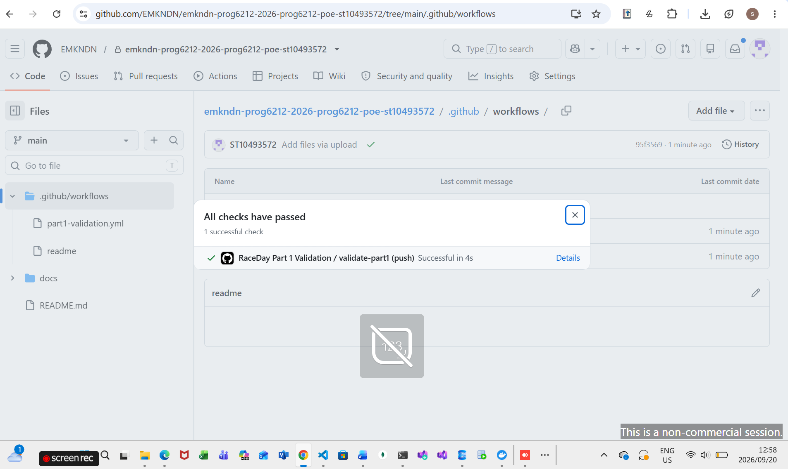

# RaceDay

RaceDay is an event management system for road running, walking and cycling events in South Africa. Organisers create events, set up categories and capture results. Participants browse events, enter a category, and follow their own enrolments and results.

This repository holds the planning documents from Part 1 (ERD, endpoint plan and SQL script) and the Part 2 RESTful API built with ASP.NET Core, Entity Framework Core and SQL Server, together with its automated tests.

## Contents

1. [Roles](#1-roles)
2. [Technology stack](#2-technology-stack)
3. [Repository structure](#3-repository-structure)
4. [Getting started](#4-getting-started)
5. [Authentication and access control](#5-authentication-and-access-control)
6. [API endpoints](#6-api-endpoints)
7. [Status codes](#7-status-codes)
8. [Image uploads](#8-image-uploads)
9. [Unit tests](#9-unit-tests)
10. [Swagger](#10-swagger)
11. [CI/CD](#11-cicd)
12. [Videos](#12-videos)
13. [References](#references)

## 1. Roles

**Organiser**
- Creates, edits and deletes their own events and uploads an event banner.
- Creates, edits and deletes categories for their events.
- Views every enrolment for their events and sets each enrolment to Pending or Confirmed.
- Captures and updates finish positions and finish times.
- Views a dashboard of their own events with the number of enrolments for each.

**Participant**
- Browses events and their categories without needing to log in.
- Enrols in an event by choosing a category, and can remove their own enrolment.
- Views their own enrolments and their own results.

Both roles can register, log in, log out, view and update their own profile, and upload a profile picture.

## 2. Technology stack

- C# and ASP.NET Core Web API on .NET 8 (Microsoft, n.d.-a)
- Entity Framework Core 8 with the code-first approach (Microsoft, n.d.-c)
- Microsoft SQL Server (Microsoft, n.d.-e)
- ASP.NET Core session middleware (Microsoft, n.d.-d)
- ASP.NET Core Identity `PasswordHasher` for password hashing
- Azure Blob Storage for images (Microsoft, n.d.-b)
- Swagger through Swashbuckle (Swashbuckle.AspNetCore contributors, n.d.)
- xUnit with an in-memory database for tests (xUnit.net contributors, n.d.)
- GitHub Actions for CI (GitHub, n.d.-a)

## 3. Repository structure

```text
Raceday/
├── .github/
│   └── workflows/
│       ├── dotnet.yml                  Part 2: build and run the tests
│       └── part1-validation.yml        Part 1: check the docs folder and files
├── docs/
│   ├── API-Endpoint-Plan.md            Endpoint plan
│   ├── RaceDay-ERD.pdf                 Entity relationship diagram
│   ├── RaceDay.sql                     Part 1 SQL Server script with sample data
│   └── workflow-validation.png         Part 1 green build screenshot
├── RaceDay.Api/
│   ├── Controllers/
│   │   ├── AuthController.cs
│   │   ├── CategoriesController.cs
│   │   ├── EnrolmentsController.cs
│   │   ├── EventsController.cs
│   │   ├── OrganiserController.cs
│   │   ├── ParticipantController.cs
│   │   ├── ResultsController.cs
│   │   └── UsersController.cs
│   ├── Data/
│   │   └── RaceDayDbContext.cs
│   ├── DTOs/
│   ├── Migrations/                     EF Core InitialCreate migration
│   ├── Models/
│   ├── Properties/
│   ├── Security/
│   │   └── SessionAuthorization.cs
│   ├── services/
│   │   ├── AzureBlobStorageService.cs
│   │   └── IAzureBlobStorageService.cs
│   ├── appsettings.json
│   ├── appsettings.Development.json
│   ├── migration-review.sql            SQL generated from the migration, kept for review
│   ├── swagger-review.json             Exported OpenAPI document, kept for review
│   ├── Program.cs
│   ├── RaceDay.Api.csproj
│   └── RaceDay.Api.http
├── RaceDay.Api.Tests/
│   ├── AuthenticationTests.cs
│   ├── AzureBlobStorageServiceTests.cs
│   ├── CategoryTests.cs
│   ├── EnrolmentStatusTests.cs
│   ├── EnrolmentTests.cs
│   ├── EventBannerUploadTests.cs
│   ├── EventTests.cs
│   ├── ProfilePictureUploadTests.cs
│   ├── RaceDayApiFactory.cs
│   ├── ResultTests.cs
│   ├── RoleAccessTests.cs
│   ├── TestSessionMiddleware.cs
│   ├── UnitTest1.cs
│   ├── UserProfileTests.cs
│   └── RaceDay.Api.Tests.csproj
└── README.md
```

## 4. Getting started

### Requirements

- .NET 8 SDK
- SQL Server (local instance, Express or Developer edition) and SQL Server Management Studio (Microsoft, n.d.-f)
- Git

### Set up the database

The database is called `RaceDay`. The API reads its connection string from `RaceDay.Api/appsettings.Development.json`:

```json
"ConnectionStrings": {
  "RaceDayConnection": "Server=localhost;Database=RaceDay;Trusted_Connection=True;TrustServerCertificate=True;Encrypt=True;"
}
```

If your SQL Server instance is not `localhost` (for example `localhost\SQLEXPRESS`), change the `Server` value. The connection uses Windows authentication, so no password is stored in the repository.

Install the EF Core command-line tool once, then create the database from the repository root:

```powershell
dotnet tool install --global dotnet-ef --version 8.*
dotnet ef database update --project RaceDay.Api
```

This creates the `RaceDay` database with all six tables (Roles, Users, Events, Categories, Enrolments, Results), their keys and constraints, and inserts the two roles, Organiser and Participant. Registration depends on those two role rows.

### Add sample data

Accounts are created through the API so that every password is properly hashed. Start the API (next section), open Swagger and call `POST /api/auth/register` once with `"roleName": "Organiser"` and once with `"roleName": "Participant"`. After that, log in as the organiser to create events and categories, then log in as the participant to enrol.

### About docs/RaceDay.sql

`docs/RaceDay.sql` is the Part 1 script. It builds the same schema as the ERD and fills it with sample data for the Part 1 demonstration. Its sample users carry placeholder password values, so they cannot log in through the API. Do not run it on a database that was created with the migration, because it drops and recreates the tables.

### Run the API

```powershell
dotnet restore
dotnet run --project RaceDay.Api
```

The API listens on `http://localhost:5191` and `https://localhost:7139`. Swagger opens at `/swagger`.

## 5. Authentication and access control

RaceDay uses session-based authentication, not JWT tokens.

- `POST /api/auth/login` checks the email and password and creates a server-side session that stores the user ID and role.
- The session is identified by the `.RaceDay.Session` cookie, which is HTTP-only, uses `SameSite=Lax` and expires after 30 minutes without activity (Microsoft, n.d.-d).
- `POST /api/auth/logout` clears the session.
- Passwords are hashed with the ASP.NET Core Identity `PasswordHasher`; only the hash is stored.
- Every protected endpoint checks the session first (401 if there is none), then the role (403 for the wrong role). Organiser endpoints also confirm that the organiser owns the event.

When testing in Swagger, log in first and keep using the same browser tab so the session cookie is sent with every request.

| Capability | Participant | Organiser |
|---|---|---|
| Browse events and categories | Yes | Yes |
| View and update own profile, upload profile picture | Yes | Yes |
| Enrol in an event, view own enrolments and results | Yes | No |
| Create, edit and delete events | No | Own events |
| Upload event banner | No | Own events |
| Manage categories | No | Own events |
| View enrolments and change enrolment status | No | Own events |
| Capture and update results | No | Own events |
| Dashboard | Participant dashboard | Organiser dashboard |

## 6. API endpoints

The full plan, with request bodies and response codes, is in [docs/API-Endpoint-Plan.md](docs/API-Endpoint-Plan.md). Swagger shows the same endpoints with live request and response details.

**Authentication**

| Method | Route | Access |
|---|---|---|
| POST | `/api/auth/register` | None (public) |
| POST | `/api/auth/login` | None (public) |
| POST | `/api/auth/logout` | Any |

**Profile and images**

| Method | Route | Access |
|---|---|---|
| GET | `/api/users/me` | Any (logged in) |
| PUT | `/api/users/me` | Any (logged in) |
| POST | `/api/users/me/profile-picture` | Any (logged in) |
| POST | `/api/events/{eventId}/banner` | Organiser (own event) |

**Events**

| Method | Route | Access |
|---|---|---|
| GET | `/api/events` | None (public) |
| GET | `/api/events/{id}` | None (public) |
| POST | `/api/events` | Organiser |
| PUT | `/api/events/{id}` | Organiser (own event) |
| DELETE | `/api/events/{id}` | Organiser (own event) |

**Categories**

| Method | Route | Access |
|---|---|---|
| GET | `/api/events/{eventId}/categories` | None (public) |
| GET | `/api/categories/{categoryId}` | None (public) |
| POST | `/api/events/{eventId}/categories` | Organiser (own event) |
| PUT | `/api/categories/{categoryId}` | Organiser (own event) |
| DELETE | `/api/categories/{categoryId}` | Organiser (own event) |

**Enrolments**

| Method | Route | Access |
|---|---|---|
| POST | `/api/events/{eventId}/enrolments` | Participant |
| POST | `/api/enrolments` | Participant |
| GET | `/api/enrolments` | Participant |
| GET | `/api/enrolments/mine` | Participant |
| GET | `/api/enrolments/{enrolmentId}` | Owning participant or the event's organiser |
| DELETE | `/api/enrolments/{enrolmentId}` | Owning participant |
| GET | `/api/events/{eventId}/enrolments` | Organiser (own event) |
| GET | `/api/organiser/events/{eventId}/enrolments` | Organiser (own event) |
| PUT | `/api/events/{eventId}/enrolments/{enrolmentId}/status` | Organiser (own event) |

**Dashboards**

| Method | Route | Access |
|---|---|---|
| GET | `/api/participant/dashboard` | Participant |
| GET | `/api/organiser/dashboard` | Organiser |

**Results**

| Method | Route | Access |
|---|---|---|
| POST | `/api/enrolments/{enrolmentId}/result` | Organiser (own event) |
| PUT | `/api/enrolments/{enrolmentId}/result` | Organiser (own event) |
| GET | `/api/enrolments/{enrolmentId}/result` | Owning participant or the event's organiser |
| GET | `/api/results/me` | Participant |
| GET | `/api/events/{eventId}/results` | Organiser (own event) |

## 7. Status codes

The status codes follow the HTTP semantics in RFC 9110 (IETF, 2022).

| Code | Meaning | Where it appears |
|---|---|---|
| 200 OK | The request succeeded | Reads, updates, login |
| 201 Created | A resource was created | Registration, events, categories, enrolments, results |
| 204 No Content | Success with no body | Deleting an event, category or enrolment |
| 400 Bad Request | The data is invalid | Missing fields, past event date, category from another event, invalid status |
| 401 Unauthorized | No valid session, or wrong credentials | Protected route without login, failed login |
| 403 Forbidden | Logged in, but not allowed | Wrong role, or an event owned by another organiser |
| 404 Not Found | The record does not exist | Unknown event, category, enrolment or result |
| 409 Conflict | The request clashes with existing data | Duplicate email, duplicate event name, duplicate enrolment, delete blocked by related records |
| 503 Service Unavailable | Image storage is unavailable | Azure Blob Storage not configured or unreachable |

## 8. Image uploads

Profile pictures and event banners are sent to the API as `multipart/form-data` in a field named `File`. The API validates the file, stores it in Azure Blob Storage (Microsoft, n.d.-b) and saves the resulting URL on the user or event record.

- Accepted types: JPEG, PNG and WebP.
- Maximum size: 5 MB.
- The API checks the content type and the file signature, and stores the blob under a generated name.

To try real uploads, add your storage account connection string as a user secret:

```powershell
dotnet user-secrets init --project RaceDay.Api
dotnet user-secrets set "AzureBlobStorage:ConnectionString" "<your connection string>" --project RaceDay.Api
```

Without it, upload endpoints return 503. The tests use a fake storage service, so they do not need Azure.

## 9. Unit tests

The tests use xUnit and an in-memory database (xUnit.net contributors, n.d.). They call the real API through `WebApplicationFactory`, log in with a session, and replace Azure storage with a fake. They cover:

- Registration (valid, duplicate email, invalid role, short password) and login (valid, wrong password), plus logout.
- Event management by an organiser, and a participant being refused.
- Category management and ownership checks.
- Enrolment: a participant enrolling, the enrolment being recorded, duplicates, and an organiser being refused.
- Enrolment status changes by the owning organiser, and refusals for participants and invalid values.
- Results, user profiles, and image uploads.

Run them from the repository root:

```powershell
dotnet test RaceDay.Api.Tests/RaceDay.Api.Tests.csproj
```

The in-memory database does not enforce every SQL Server rule, so the database constraints themselves are checked against SQL Server through the migration.

## 10. Swagger

Swagger UI is enabled in the Development environment (Swashbuckle.AspNetCore contributors, n.d.). Each endpoint shows a description from the XML comments, its parameters, its request body and its response codes.

1. Run `dotnet run --project RaceDay.Api`.
2. Open `http://localhost:5191/swagger`.
3. Call `POST /api/auth/login` as a participant or an organiser, then try the protected endpoints.

## 11. CI/CD

Two GitHub Actions workflows live in `.github/workflows/` (GitHub, n.d.-a):

- `dotnet.yml` restores, builds the API in Release mode and runs the full test suite on every push and pull request to `main`, `master` and `part-2`.
- `part1-validation.yml` checks that the `docs` folder, the ERD, the endpoint plan and the SQL script are present and that the SQL script creates all six tables.
  
**Part 1 green build**





**Part 2 green build**


## 12. Videos

- Part 1 presentation: https://youtu.be/fY9Pm7SFSSg
- Part 2 API demonstration: <add unlisted YouTube link>

## References

GitHub (n.d.-a) *About GitHub Actions*. Available at: https://docs.github.com/en/actions/about-github-actions (Accessed: 18 October 2026).

IETF (2022) *RFC 9110: HTTP Semantics*. Available at: https://www.rfc-editor.org/rfc/rfc9110 (Accessed: 18 October 2026).

Microsoft (n.d.-a) *ASP.NET Core Web API*. Available at: https://learn.microsoft.com/en-us/aspnet/core/web-api/ (Accessed: 18 October 2026).

Microsoft (n.d.-b) *Azure Blob Storage documentation*. Available at: https://learn.microsoft.com/en-us/azure/storage/blobs/ (Accessed: 18 October 2026).

Microsoft (n.d.-c) *Entity Framework Core documentation*. Available at: https://learn.microsoft.com/en-us/ef/core/ (Accessed: 18 October 2026).

Microsoft (n.d.-d) *Session and state management in ASP.NET Core*. Available at: https://learn.microsoft.com/en-us/aspnet/core/fundamentals/app-state (Accessed: 18 October 2026).

Microsoft (n.d.-e) *SQL Server documentation*. Available at: https://learn.microsoft.com/en-us/sql/sql-server/ (Accessed: 18 October 2026).

Microsoft (n.d.-f) *SQL Server Management Studio*. Available at: https://learn.microsoft.com/en-us/ssms/ (Accessed: 18 October 2026).

Swashbuckle.AspNetCore contributors (n.d.) *Swashbuckle.AspNetCore*. Available at: https://github.com/domaindrivendev/Swashbuckle.AspNetCore (Accessed: 18 October 2026).

xUnit.net contributors (n.d.) *xUnit.net*. Available at: https://xunit.net/ (Accessed: 18 October 2026).
